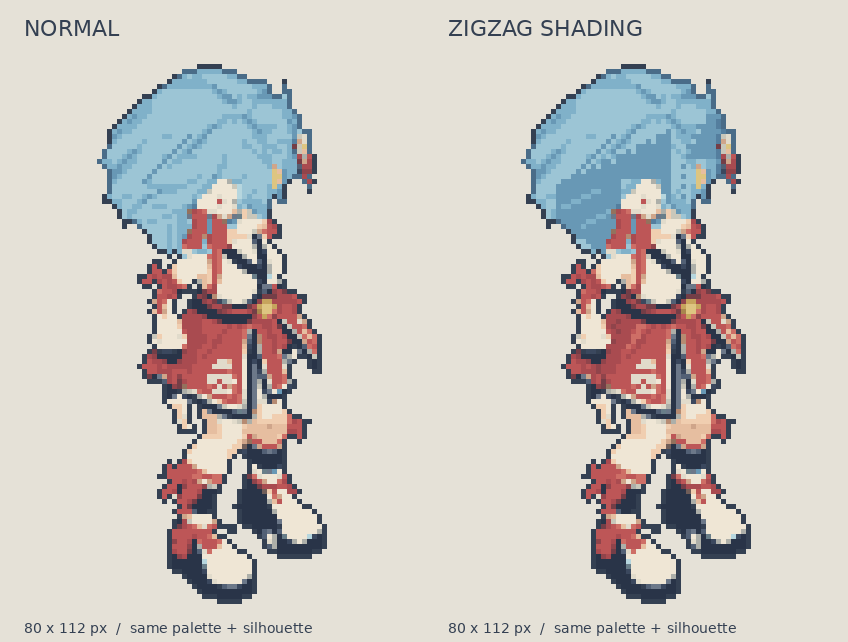

# 緋月・ジグザグ陰影 v1（比較実験）

80×112px・30色・40°俯瞰・Idle斜め前1コマ。`normal.png` を元に、髪285px・赤い服21pxの陰影を変更した別候補。通常版の角落としを引き継ぎ、今回のalpha変更は0px。輪郭・足元・ポーズ・パレットは同一。アニメ未制作・本編未反映・美術採用前。



## 別チャットでの再現

このフォルダと `skills/silhouette-first-pixel-art/` を同じレポジトリから取得する。Pillow・NumPyはスキルの `requirements.txt` に従う。以後の実行に画像生成や外部API、元GLBの再レンダリングは不要。

レポジトリルートで実行する：

```bash
python experiments/pixel-zigzag-v1/reproduce.py --output /tmp/hizuki-zigzag-replay
```

`Hizuki_zigzag_80x112.png` と検査JSONが出力される。`reference.png` と全RGBA一致、alpha不変、パレット30色一致、部位ガードを確認し、違えば停止する。PNGの圧縮バイトではなく画素を比較する。`normal.png` やパッチを別ポーズのものへ差し替えない。

## 描画手順も再実行する場合

```bash
python experiments/pixel-zigzag-v1/paint_recipe.py
```

このコマンドは選んだポリゴン・行別の境界・材質色から描き直し、同フォルダ内 `painting_output/` に部位別候補・差分・比較を作る。比較画像の文字はDejaVuSansを使い、未導入ならPillowの既定フォントへ切り替える。文字の見た目はキャラのRGBA再現検査に含めない。再現の正本は `recipe.json` と2つのパッチ、および `reference.png`。汎用的な描き方は [ジグザグ陰影のスキル手順](../../skills/silhouette-first-pixel-art/docs/ZIGZAG_SHADING.md) を読む。

## ファイルと出典

- `normal.png`：比較元の通常版。Library `libfile_a651ae5af2d8819182b2f0287f0dc5be` と同じPNG。元工程・配色・接地点は `normal_production_record.json`。
- `reference.png`：今回のジグザグ陰影候補。`verification.json` に変更数・RGBAハッシュ・部位検査。
- `recipe.json`：版違いを防ぐ入力／出力RGBAハッシュ、方向、寸法、接地点、パッチ順。
- `hair_patch.json` / `cloth_patch.json`：全変更座標・変更前後RGBAを記録。
- `edit_guard.json` と3つのマスク：今回のポーズ用に注釈した編集範囲・保護範囲。別画像へ自動転用しない。
- `paint_recipe.py`：髪の束に沿う1〜2pxの境界、影の色面、控えめな束の明部、服の折れ目を描く具体的な作画レシピ。

元はV35の `ortho40 / Idle / front_right / src0000`。通常版の制作工程を最初からやり直す場合は `normal_production_record.json` の元素材参照・原画SHA・既存差分を照合する。この実験だけで元GLBからのピクセル化全工程を再現できるとは扱わない。

添付されたエターニアのゲーム画面は陰影境界の見せ方の参考。原作スプライトの正確な復元・原作処理方式の解析ではない。今回は影の面積も変えているため、「ギザギザの有無だけ」の比較とは区別する。強さの比較を続けるときは同じ通常版から分岐する。
